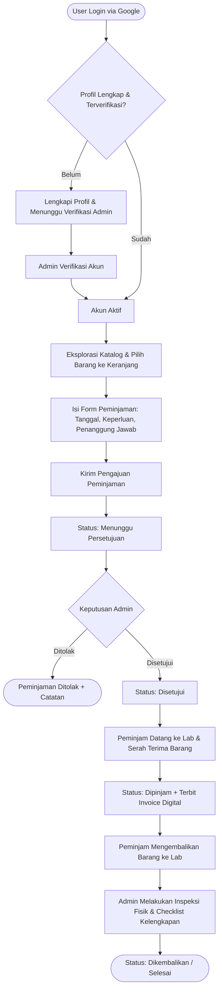

<p align="center">
  
</p>

<h1 align="center">📦 PinjamIn</h1>

<p align="center">
  <strong>Sistem Manajemen & Peminjaman Alat Laboratorium FIT — <em>Pinjam alat, tanpa ribet</em></strong>
</p>

<p align="center">
  <a href="#-fitur-utama"></a>
  <a href="https://react.dev/"></a>
  <a href="https://www.typescriptlang.org/"></a>
  <a href="https://tailwindcss.com/"></a>
  <a href="https://vite.dev/"></a>
  <a href="https://firebase.google.com/"></a>
  <a href="https://vitest.dev/"></a>
</p>

---

## 📖 Tentang PinjamIn

**PinjamIn** adalah platform berbasis web modern yang dirancang khusus untuk memfasilitasi dan mendigitalisasi seluruh siklus peminjaman alat dan aset di lingkungan **Laboratorium Fakultas Ilmu Terapan (FIT)**. 

Platform ini menggantikan sistem pencatatan peminjaman manual berbasis kertas atau spreadsheet yang rentan kesalahan dan sulit dilacak. Dengan **PinjamIn**, seluruh civitas akademika (Mahasiswa, Dosen, dan Tenaga Kependidikan) dapat mencari ketersediaan alat secara *real-time*, mengajukan booking, mendapatkan invoice digital resmi, serta memantau status peminjaman dengan transparansi penuh. Di sisi pengelola, staf laboran memiliki dasbor komprehensif untuk memverifikasi pengguna, mengontrol serah terima dan inspeksi fisik pengembalian barang, mengelola inventaris aset, dan menganalisis tren peminjaman.

---

## 📑 Daftar Isi

- [📖 Tentang PinjamIn](#-tentang-pinjamin)
- [✨ Fitur Utama](#-fitur-utama)
  - [🎒 Pengalaman Peminjam (User Experience)](#-pengalaman-peminjam-user-experience)
  - [🛡️ Panel Administrator & Laboran](#️-panel-administrator--laboran)
  - [📄 Invoice Digital & Bukti Peminjaman](#-invoice-digital--bukti-peminjaman)
- [🔄 Alur Peminjaman (Workflow)](#-alur-peminjaman-workflow)
- [🛠️ Tech Stack & Arsitektur](#️-tech-stack--arsitektur)
- [📂 Struktur Direktori](#-struktur-direktori)
- [🚀 Panduan Instalasi & Pengembangan](#-panduan-instalasi--pengembangan)
  - [Prasyarat](#prasyarat)
  - [Langkah Instalasi](#langkah-instalasi)
  - [Konfigurasi Firebase](#konfigurasi-firebase)
  - [Perintah Tersedia](#perintah-tersedia)
- [🔐 Aturan Keamanan & Hak Akses (RBAC)](#-aturan-keamanan--hak-akses-rbac)
- [📋 Kebijakan Default Peminjaman](#-kebijakan-default-peminjaman)
- [🤝 Kontribusi](#-kontribusi)
- [📄 Lisensi](#-lisensi)

---

## ✨ Fitur Utama

### 🎒 Pengalaman Peminjam (User Experience)
* **Single Sign-On (Google Auth):** Masuk cepat menggunakan akun Google dengan pencatatan email terverifikasi.
* **Lengkapi Profil Terstandarisasi:** Validasi data diri resmi mencakup Tipe Peminjam (Mahasiswa, Dosen, Tendik), Nomor Identitas (NIM / NIP / NIDN), Program Studi / Unit Kerja, Angkatan, serta Nomor WhatsApp aktif.
* **Katalog Aset Real-time:** 
  * Pencarian instan dan filter berdasarkan kategori (Kamera, Tripod, Audio, Jaringan, Komputer, VR/AR, dll.).
  * Filter ketersediaan barang (*Tersedia, Dipinjam, Perawatan, Rusak*) dan kondisi fisik (*Baik, Perlu Cek*).
  * Modal detail alat komprehensif: spesifikasi teknis, merek & tipe, nomor seri, lokasi penyimpanan, dan kelengkapan bawaan (misal: baterai cadangan, kabel data, tas).
* **Multi-Item Cart (Keranjang Booking):** Pilih beberapa alat sekaligus dalam satu kali pengajuan peminjaman.
* **Validasi Kebijakan Cerdas:** Form peminjaman secara otomatis memeriksa batas maksimal durasi hari dan kuota barang sesuai peran pengguna, serta mewajibkan dosen penanggung jawab untuk mahasiswa.
* **Riwayat Peminjaman Dinamis:** Tab riwayat dengan lencana status berwarna, estimasi waktu jatuh tempo, indikator peringatan keterlambatan (*overdue*), dan riwayat pengembalian barang.

### 🛡️ Panel Administrator & Laboran
* **Verifikasi Pengguna Terpusat:** Meninjau dan menyetujui akun baru sebelum diizinkan meminjam barang, serta memproses permintaan perubahan data identitas.
* **Manajemen Peminjaman & Serah Terima:**
  * **Persetujuan / Penolakan:** Menyetujui pengajuan atau memberikan alasan penolakan yang jelas.
  * **Serah Terima (*Handover*):** Mengonfirmasi penyerahan fisik barang kepada peminjam.
  * **Inspeksi Pengembalian (*Return Checklist*):** Formulir inspeksi kondisi fisik barang (*Baik / Perlu Cek / Rusak*) dan checklist kelengkapan aksesoris saat barang dikembalikan, dilengkapi catatan laboran.
* **Manajemen Inventaris & Aset:** Tambah, edit, dan hapus aset laboratorium lengkap dengan foto, kode aset terstandarisasi, nomor seri, dan tahun perolehan.
* **Kategori & Prefix Otomatis:** Pengelompokan aset dengan kode prefix otomatis (misal: `CAM` untuk Kamera, `AUD` untuk Audio, `KOM` untuk Komputer).
* **Konfigurasi Kebijakan Fleksibel:** Pengaturan batas maksimal durasi pinjam, batas maksimal jumlah barang, dan kewajiban penanggung jawab yang dapat disesuaikan per kategori peminjam (Mahasiswa, Dosen, Tendik).
* **Statistik & Analisis Riwayat:** Ringkasan metrik peminjaman aktif, barang dalam perbaikan, dan grafik tren peminjaman berdasarkan filter waktu (30 hari, 3 bulan, 1 tahun, atau semua waktu).

### 📄 Invoice Digital & Bukti Peminjaman
* **Nomor Invoice Otomatis:** Format penomoran dokumen resmi unik per transaksi.
* **Bukti Serah Terima Resmi:** Dokumen digital memuat data peminjam, dosen penanggung jawab, daftar alat beserta kelengkapan, tanggal pinjam, batas pengembalian, dan cap verifikasi.
* **Akses Cepat & Cetak:** Fitur cetak/simpan PDF langsung dari browser dan tautan cepat ke WhatsApp Helpdesk Laboratorium FIT (`0851-7208-8181`).
* **Proteksi Akses:** Peminjam hanya dapat membuka invoice miliknya sendiri, sementara administrator dapat mengakses seluruh arsip invoice.

---

## 🔄 Alur Peminjaman (Workflow)



---

## 🛠️ Tech Stack & Arsitektur

| Lapisan | Teknologi | Kegunaan |
| :--- | :--- | :--- |
| **Frontend Framework** | **React 19** (`react`, `react-dom`) | UI Library modern berbasis komponen fungsional dan React Hooks |
| **Language** | **TypeScript 5.x** | *Static typing* ketat untuk keamanan tipe data dan skalabilitas kode |
| **Styling & UI** | **Tailwind CSS v4** | Utility-first CSS framework untuk tampilan responsif dan performa tinggi |
| **Build Tool & Bundler** | **Vite 8** | Development server ultra-cepat dengan Hot Module Replacement (HMR) |
| **Icons & Media** | **React Bootstrap Icons** | Set ikon modern dan konsisten |
| **Database & Auth** | **Firebase Cloud Firestore & Auth** | Database NoSQL real-time, autentikasi Google, dan keamanan tingkat baris |
| **Security Rules** | **Firestore Security Rules** | Kontrol hak akses berbasis role (RBAC) di sisi database |
| **Unit Testing** | **Vitest** | Runner pengujian unit berkecepatan tinggi untuk utilitas tanggal dan logika |
| **Deployment** | **Vercel / Cloud Hosting** | Dukungan SPA routing dengan konfigurasi rewrite (`vercel.json`) |

---

## 📂 Struktur Direktori

```text
PinjamIn/
├── public/                       # Aset publik statis (favicon.svg, logo)
├── src/
│   ├── components/               # Komponen antarmuka pengguna (UI)
│   │   ├── admin/                # Komponen khusus panel administrator
│   │   │   └── AdminDashboard.tsx# Dasbor lengkap laboran (verifikasi, inventaris, serah terima)
│   │   ├── CompleteProfileModal.tsx # Modal pengisian profil awal pengguna baru
│   │   ├── Icon.tsx              # Komponen wrapper render icon SVG
│   │   ├── InvoiceView.tsx       # Tampilan & cetak invoice digital resmi
│   │   ├── ItemCatalog.tsx       # Katalog interaktif pencarian & keranjang barang
│   │   ├── LoanModal.tsx         # Modal formulir pengajuan peminjaman
│   │   ├── LoginScreen.tsx       # Halaman landing & autentikasi Google
│   │   ├── MyLoans.tsx           # Halaman riwayat peminjaman pengguna
│   │   ├── MyProfile.tsx         # Halaman profil & pengajuan update identitas
│   │   ├── Navbar.tsx            # Navigasi utama responsif (mobile, tablet, desktop)
│   │   ├── PendingVerificationScreen.tsx # Halaman tunggu verifikasi akun
│   │   └── PinjamInIcon.tsx      # Komponen logo vektor resmi PinjamIn
│   ├── context/
│   │   └── AuthContext.tsx       # Global state autentikasi & profil user
│   ├── lib/
│   │   ├── adminConfig.ts        # Konfigurasi email & validasi status admin
│   │   ├── dateUtils.ts          # Utilitas format tanggal Indonesia & validasi durasi
│   │   ├── dateUtils.test.ts     # Unit testing vitest untuk kalkulasi tanggal
│   │   └── firebase.ts           # Inisialisasi Firebase App, Auth, dan Firestore
│   ├── types/
│   │   └── index.ts              # Definisi interface TypeScript (Item, Loan, User, dll.)
│   ├── App.tsx                   # Komponen induk aplikasi & penanganan rute
│   ├── index.css                 # Konfigurasi Tailwind CSS v4 & styling global
│   ├── landing.css               # Styling dekoratif & animasi landing page
│   └── main.tsx                  # Entry point aplikasi React
├── firestore.rules               # Aturan keamanan database Cloud Firestore
├── firebase-applet-config.json   # Konfigurasi kredensial Firebase web client
├── package.json                  # Metadata proyek & daftar dependensi
├── tsconfig.json                 # Konfigurasi kompilator TypeScript
├── vercel.json                   # Konfigurasi rewrite SPA untuk deployment Vercel
├── vite.config.ts                # Konfigurasi Vite & Tailwind plugin
└── README.md                     # Dokumentasi resmi proyek
```

---

## 🚀 Panduan Instalasi & Pengembangan

### Prasyarat
Pastikan lingkungan pengembangan Anda telah terpasang:
* **Node.js** (versi `20.x` atau lebih baru, direkomendasikan `22+`)
* **npm** atau **bun** / **yarn** / **pnpm**
* Proyek **Firebase** aktif dengan Firestore & Google Authentication diaktifkan.

### Langkah Instalasi

1. **Clone repositori:**
   ```bash
   git clone https://github.com/luthafiyyan/PinjamIn.git
   cd PinjamIn
   ```

2. **Instal seluruh dependensi proyek:**
   ```bash
   npm install
   ```

3. **Konfigurasi Firebase:**
   Pastikan file `firebase-applet-config.json` berada di root proyek dengan struktur kredensial Firebase web Anda:
   ```json
   {
     "projectId": "your-firebase-project-id",
     "appId": "your-firebase-app-id",
     "apiKey": "your-firebase-api-key",
     "authDomain": "your-app.firebaseapp.com",
     "firestoreDatabaseId": "(default)",
     "storageBucket": "your-app.firebasestorage.app",
     "messagingSenderId": "your-sender-id"
   }
   ```

4. **Konfigurasi Variabel Lingkungan (Opsional):**
   Salin `.env.example` ke `.env` jika diperlukan:
   ```bash
   cp .env.example .env
   ```

5. **Jalankan server pengembangan lokal:**
   ```bash
   npm run dev
   ```
   Aplikasi akan berjalan pada `http://localhost:3000`.

---

### Perintah Tersedia

| Perintah | Deskripsi |
| :--- | :--- |
| `npm run dev` | Menjalankan Vite development server pada port `3000` |
| `npm run build` | Melakukan kompilasi aset produksi ke folder `dist/` |
| `npm run preview` | Meninjau hasil build produksi secara lokal |
| `npm run lint` | Menjalankan pemeriksaan tipe data TypeScript (`tsc --noEmit`) |
| `npm test` | Menjalankan unit test dengan Vitest |

---

## 🔐 Aturan Keamanan & Hak Akses (RBAC)

PinjamIn menerapkan keamanan data berlapis menggunakan **Cloud Firestore Security Rules**:

1. **Peminjam (Mahasiswa, Dosen, Tendik):**
   * Hanya dapat membaca dan memperbarui profil miliknya sendiri (nomor HP, unit kerja, angkatan, permohonan koreksi).
   * Hanya dapat membaca katalog barang dan riwayat peminjaman miliknya sendiri.
   * Hanya dapat melihat invoice peminjaman yang diajukan oleh akun miliknya.
   * Tidak dapat mengubah status transaksi atau memodifikasi data inventaris.

2. **Administrator & Laboran:**
   * Diidentifikasi melalui alamat email resmi administrator yang terverifikasi (`hafiyyanluthfii@gmail.com` yang dikonfigurasi di `adminConfig.ts` & `firestore.rules`).
   * Memiliki akses penuh untuk membaca, membuat, menyetujui, dan memperbarui seluruh data inventaris, pengguna, transaksi, dan aturan peminjaman.

Deploy aturan Firestore ke lingkungan Firebase Anda:
```bash
firebase deploy --only firestore:rules
```

---

## 📋 Kebijakan Default Peminjaman

Aturan peminjaman dapat disesuaikan sewaktu-waktu oleh Admin melalui menu **Pengaturan** di Dasbor Admin:

| Tipe Peminjam | Maks. Durasi Peminjaman | Maks. Jumlah Barang | Wajib Dosen Penanggung Jawab |
| :--- | :---: | :---: | :---: |
| **Mahasiswa** | 3 Hari | 2 Barang | **Ya** (Nama & NIP Dosen) |
| **Dosen** | 7 Hari | 5 Barang | Tidak |
| **Tendik** | 7 Hari | 5 Barang | Tidak |

---

## 📄 Lisensi

Proyek ini dikembangkan untuk kebutuhan internal laboratorium dan didistribusikan di bawah lisensi **MIT License**.

---

<p align="center">
  Developed by <strong>Luthafiyyan</strong> untuk <strong>Laboratorium FIT</strong>
</p>
