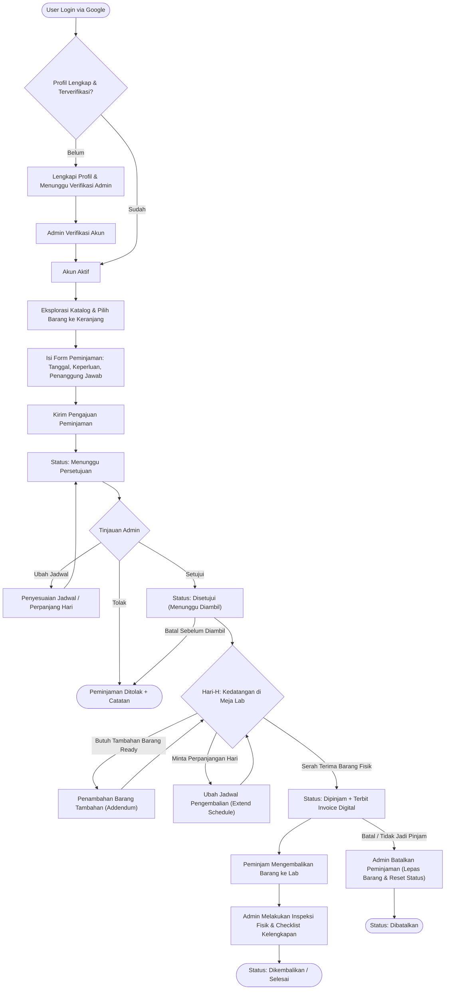

<p align="center">
  
</p>

<h1 align="center">📦 PinjamIn</h1>

<p align="center">
  <strong>Sistem Manajemen & Peminjaman Alat Laboratorium FIT • <em>Pinjam alat, tanpa ribet</em></strong>
</p>

<p align="center">
  <a href="#-fitur-utama"></a>
  <a href="https://react.dev/"></a>
  <a href="https://www.typescriptlang.org/"></a>
  <a href="https://tailwindcss.com/"></a>
  <a href="https://vite.dev/"></a>
  <a href="https://firebase.google.com/"></a>
  <a href="https://vitest.dev/"></a>
</p>

---

## 📖 Tentang PinjamIn

**PinjamIn** adalah platform berbasis web modern yang dirancang khusus untuk memfasilitasi dan mendigitalisasi seluruh siklus peminjaman alat dan aset di lingkungan **Laboratorium Fakultas Ilmu Terapan (FIT)**. 

Platform ini menggantikan sistem pencatatan peminjaman manual berbasis kertas atau spreadsheet yang rentan kesalahan dan sulit dilacak. Dengan **PinjamIn**, seluruh civitas akademika (Mahasiswa, Dosen, dan Tenaga Kependidikan) dapat mencari ketersediaan alat secara *real-time*, mengajukan booking, mendapatkan invoice digital resmi, serta memantau status peminjaman dengan transparansi penuh. Di sisi pengelola, staf laboran memiliki dasbor komprehensif untuk memverifikasi pengguna, mengontrol serah terima dan inspeksi fisik pengembalian barang, mengelola inventaris aset, dan menganalisis tren peminjaman.

---

## 📑 Daftar Isi

- [📖 Tentang PinjamIn](#-tentang-pinjamin)
- [✨ Fitur Utama](#-fitur-utama)
  - [🎒 Pengalaman Peminjam (User Experience)](#-pengalaman-peminjam-user-experience)
  - [🛡️ Panel Administrator & Laboran](#️-panel-administrator--laboran)
  - [📄 Invoice Digital & Bukti Peminjaman](#-invoice-digital--bukti-peminjaman)
- [🔄 Alur Peminjaman (Workflow)](#-alur-peminjaman-workflow)
- [🛠️ Tech Stack & Arsitektur](#️-tech-stack--arsitektur)
- [📂 Struktur Direktori](#-struktur-direktori)
- [🚀 Panduan Instalasi & Pengembangan](#-panduan-instalasi--pengembangan)
  - [Prasyarat](#prasyarat)
  - [Langkah Instalasi](#langkah-instalasi)
  - [Konfigurasi Firebase](#konfigurasi-firebase)
  - [Perintah Tersedia](#perintah-tersedia)
- [🔐 Aturan Keamanan & Hak Akses (RBAC)](#-aturan-keamanan--hak-akses-rbac)
- [📋 Kebijakan Default Peminjaman](#-kebijakan-default-peminjaman)
- [🤝 Kontribusi](#-kontribusi)
- [📄 Lisensi](#-lisensi)

---

## ✨ Fitur Utama

### 🎒 Pengalaman Peminjam (User Experience)
* **Single Sign-On (Google Auth):** Masuk cepat menggunakan akun Google dengan pencatatan email terverifikasi.
* **Lengkapi Profil Terstandarisasi:** Validasi data diri resmi mencakup Tipe Peminjam (Mahasiswa, Dosen, Tendik), Nomor Identitas (NIM / NIP / NIDN), Program Studi / Unit Kerja, Angkatan, serta Nomor WhatsApp aktif.
* **Katalog Aset Real-time:** 
  * Pencarian instan dan filter berdasarkan kategori (Kamera, Tripod, Audio, Jaringan, Komputer, VR/AR, dll.).
  * Filter ketersediaan barang (*Tersedia, Dipinjam, Perawatan, Rusak*) dan kondisi fisik (*Baik, Perlu Cek*).
  * Modal detail alat komprehensif: spesifikasi teknis, merek & tipe, nomor seri, lokasi penyimpanan, dan kelengkapan bawaan (misal: baterai cadangan, kabel data, tas).
* **Multi-Item Cart (Keranjang Booking):** Pilih beberapa alat sekaligus dalam satu kali pengajuan peminjaman.
* **Validasi Kebijakan Cerdas:** Form peminjaman secara otomatis memeriksa batas maksimal durasi hari dan kuota barang sesuai peran pengguna, serta mewajibkan dosen penanggung jawab untuk mahasiswa.
* **Riwayat Peminjaman Dinamis:** Tab riwayat dengan lencana status berwarna, estimasi waktu jatuh tempo, indikator peringatan keterlambatan (*overdue*), dan riwayat pengembalian barang.

### 🛡️ Panel Administrator & Laboran
* **Verifikasi Pengguna Terpusat:** Meninjau dan menyetujui akun baru sebelum diizinkan meminjam barang, serta memproses permintaan perubahan data identitas.
* **Delegasi Akses Admin (Superadmin Only):** Akun Superadmin dapat mempromosikan pengguna terdaftar menjadi Admin Lab atau mencabut akses admin langsung dari dasbor web tanpa perlu menyentuh kode sumber.
* **Manajemen Peminjaman & Serah Terima:**
  * **Persetujuan / Penolakan & Penyesuaian Jadwal:** Meninjau pengajuan, menyetujui, menolak dengan alasan yang transparan, atau menyesuaikan jadwal tanggal kembali sebelum pengajuan disetujui.
  * **Penambahan Barang di Hari-H (Skema Addendum Meja Lab):** Fasilitas fleksibel saat peminjam tiba di laboratorium pada hari-H dan membutuhkan alat tambahan yang berstatus *Tersedia*. Admin dapat memilih barang tambahan langsung dari modal interaktif, sekaligus menyesuaikan tanggal kembali jika diperlukan, mengevaluasi kuota peran dengan dukungan persetujuan khusus (*Admin Override*), serta memilih opsi simpan ke invoice atau simpan & langsung serahkan seluruh barang secara instan dalam 1 nomor invoice yang sama.
  * **Penyesuaian Jadwal Pengembalian (*Extend Loan Schedule*):** Fitur fleksibel untuk memperpanjang batas tanggal kembali sebelum barang diserahkan ke peminjam. Dilengkapi dengan validasi bentrok reservasi secara otomatis (*real-time conflict detection*), perhitungan durasi hari terhadap kuota role, persetujuan khusus admin (*Admin Override*), dan sinkronisasi instan ke invoice serta kalender ketersediaan alat.
  * **Serah Terima (*Handover*):** Mengonfirmasi penyerahan fisik barang kepada peminjam dengan validasi kondisi alat terbaru secara atomik.
  * **Pembatalan Peminjaman Cepat (*Instant Cancel*):** Tombol pembatalan pada kartu peminjaman aktif jika peminjam tidak jadi menggunakan alat di hari-H. Seluruh alat fisik otomatis dipulihkan ke status *Tersedia* dan slot kalender dibebaskan seketika tanpa perlu mengisi formulir checklist inspeksi pengembalian.
  * **Inspeksi Pengembalian (*Return Checklist*):** Formulir inspeksi kondisi fisik barang (*Baik / Perlu Cek / Rusak*) dan checklist kelengkapan aksesoris saat barang dikembalikan, dilengkapi catatan laboran.
* **Pencatatan Peminjaman Walk-In / Manual:** Staf laboran dapat mencatatkan peminjaman langsung untuk peminjam *offline* / di tempat dengan memilih pengguna terdaftar atau mengisi identitas peminjam kustom (Nama, Kontak, Tipe Peminjam, NIM/NIP, Unit Asal) serta memilih status awal langsung (*Disetujui* atau *Langsung Dipinjamkan*).
* **Manajemen Inventaris & Aset:** Tambah, edit, dan hapus aset laboratorium lengkap dengan foto, kode aset terstandarisasi, nomor seri, dan tahun perolehan.
* **Kategori & Prefix Otomatis:** Pengelompokan aset dengan kode prefix otomatis (misal: `CAM` untuk Kamera, `AUD` untuk Audio, `KOM` untuk Komputer).
* **Konfigurasi Kebijakan Fleksibel:** Pengaturan batas maksimal durasi pinjam, batas maksimal jumlah barang, dan kewajiban penanggung jawab yang dapat disesuaikan per kategori peminjam (Mahasiswa, Dosen, Tendik).
* **Statistik & Analisis Riwayat:** Ringkasan metrik peminjaman aktif, barang dalam perbaikan, dan grafik tren peminjaman berdasarkan filter waktu (30 hari, 3 bulan, 1 tahun, atau semua waktu).
* **Desain Desktop Full-Width Responsif:** Dasbor administrasi, katalog, dan bilah navigasi memanfaatkan layar monitor desktop *widescreen* secara optimal (*fluid full-width layout*) agar tabel data dan metrik tidak sempit.

### 📄 Form Bukti Peminjaman Resmi (Invoice A5)
* **Format Blanko Formal Laboratorium FIT:** Mengikuti standar resmi Administrasi Laboratorium Fakultas Ilmu Terapan dengan kop surat simetris dan logo resmi Lab FIT.
* **Titimangsa Formal Bahasa Indonesia:** Penulisan tanggal surat resmi otomatis (`Bandung, [DD] [Nama Bulan] [YYYY]`, contoh: *Bandung, 29 Oktober 2026*).
* **Metadata Peminjaman 2 Kolom Sejajar:** Data terstruktur mencakup Nomor Invoice unik, Nama Peminjam, Nomor Identitas (NIM/NIP), Kontak HP/WA, Tanggal Pinjam, Batas Pengembalian (otomatis tersinkronisasi saat jadwal diperpanjang), Keperluan (*Capitalized Case*), dan Status persetujuan.
* **Tabel Barang Solid Klasik:** Daftar inventaris rapi dengan kolom No, Nama Barang & Spesifikasi Teknis, Kode Aset, Jumlah Unit, serta Keterangan Kelengkapan dan Kondisi Pinjam. Seluruh item otomatis tersinkronisasi secara real-time termasuk jika terdapat penambahan barang di hari-H (addendum meja lab).
* **Tanda Tangan Dua Pihak:** Blok pengesahan resmi berdampingan antara Petugas Laboratorium FIT (kiri) dan Peminjam (kanan).
* **Siap Cetak Kertas A5:** Tampilan dan styling cetak (`@media print`) dioptimalkan khusus untuk ukuran kertas A5 tanpa terpotong atau berantakan saat dicetak atau disimpan ke PDF.
* **Proteksi Akses Dokumen:** Peminjam hanya dapat membuka bukti peminjaman miliknya sendiri, sementara administrator dapat mengakses seluruh arsip invoice.

---

## 🔄 Alur Peminjaman (Workflow)



---

## 🛠️ Tech Stack & Arsitektur

| Lapisan | Teknologi | Kegunaan |
| :--- | :--- | :--- |
| **Frontend Framework** | **React 19** (`react`, `react-dom`) | UI Library modern berbasis komponen fungsional dan React Hooks |
| **Language** | **TypeScript 5.x** | *Static typing* ketat untuk keamanan tipe data dan skalabilitas kode |
| **Styling & UI** | **Tailwind CSS v4** | Utility-first CSS framework untuk tampilan responsif dan performa tinggi |
| **Build Tool & Bundler** | **Vite 8** | Development server ultra-cepat dengan Hot Module Replacement (HMR) |
| **Icons & Media** | **React Bootstrap Icons** | Set ikon modern dan konsisten |
| **Database & Auth** | **Firebase Cloud Firestore & Auth** | Database NoSQL real-time, autentikasi Google, dan keamanan tingkat baris |
| **Security Rules** | **Firestore Security Rules** | Kontrol hak akses berbasis role (RBAC) di sisi database |
| **Unit Testing** | **Vitest** | Runner pengujian unit berkecepatan tinggi untuk utilitas tanggal dan logika |
| **Aksesibilitas & UI** | **WCAG 2.1 AA & Antislop** | Rasio kontras AA, ring fokus keyboard (`:focus-visible`), toleransi *prefers-reduced-motion*, dan bebas AI slop |
| **Deployment** | **Vercel / Cloud Hosting** | Dukungan SPA routing dengan konfigurasi rewrite (`vercel.json`) |

---

## 📂 Struktur Direktori

```text
PinjamIn/
├── public/                       # Aset publik statis (favicon.svg, logo)
├── src/
│   ├── components/               # Komponen antarmuka pengguna (UI)
│   │   ├── admin/                # Komponen khusus panel administrator
│   │   │   └── AdminDashboard.tsx# Dasbor lengkap laboran (verifikasi, inventaris, serah terima)
│   │   ├── CompleteProfileModal.tsx # Modal pengisian profil awal pengguna baru
│   │   ├── Icon.tsx              # Komponen wrapper render icon SVG
│   │   ├── InvoiceView.tsx       # Tampilan & cetak invoice digital resmi
│   │   ├── ItemCatalog.tsx       # Katalog interaktif pencarian & keranjang barang
│   │   ├── LoanModal.tsx         # Modal formulir pengajuan peminjaman
│   │   ├── LoginScreen.tsx       # Halaman landing & autentikasi Google
│   │   ├── MyLoans.tsx           # Halaman riwayat peminjaman pengguna
│   │   ├── MyProfile.tsx         # Halaman profil & pengajuan update identitas
│   │   ├── Navbar.tsx            # Navigasi utama responsif (mobile, tablet, desktop)
│   │   ├── PendingVerificationScreen.tsx # Halaman tunggu verifikasi akun
│   │   └── PinjamInIcon.tsx      # Komponen logo vektor resmi PinjamIn
│   ├── context/
│   │   └── AuthContext.tsx       # Global state autentikasi & profil user
│   ├── lib/
│   │   ├── adminConfig.ts        # Helper & validasi status peran admin/superadmin
│   │   ├── dateUtils.ts          # Utilitas format tanggal Indonesia & validasi durasi
│   │   ├── dateUtils.test.ts     # Unit testing vitest untuk kalkulasi tanggal
│   │   └── firebase.ts           # Inisialisasi Firebase App, Auth, dan Firestore
│   ├── types/
│   │   └── index.ts              # Definisi interface TypeScript (Item, Loan, User, dll.)
│   ├── App.tsx                   # Komponen induk aplikasi & penanganan rute
│   ├── index.css                 # Konfigurasi Tailwind CSS v4 & styling global
│   ├── landing.css               # Styling dekoratif & animasi landing page
│   └── main.tsx                  # Entry point aplikasi React
├── .firebaserc                   # Target proyek Firebase CLI
├── firebase.json                 # Pemetaan deployment database Firestore
├── firestore.rules               # Aturan keamanan database Cloud Firestore
├── firebase-applet-config.json   # Konfigurasi kredensial Firebase web client
├── package.json                  # Metadata proyek & daftar dependensi
├── tsconfig.json                 # Konfigurasi kompilator TypeScript
├── vercel.json                   # Konfigurasi rewrite SPA & security headers Vercel
├── vite.config.ts                # Konfigurasi Vite & Tailwind plugin
└── README.md                     # Dokumentasi resmi proyek
```

---

## 🚀 Panduan Instalasi & Pengembangan

### Prasyarat
Pastikan lingkungan pengembangan Anda telah terpasang:
* **Node.js** (versi `20.x` atau lebih baru, direkomendasikan `22+`)
* **npm** atau **bun** / **yarn** / **pnpm**
* Proyek **Firebase** aktif dengan Firestore & Google Authentication diaktifkan.

### Langkah Instalasi

1. **Clone repositori:**
   ```bash
   git clone https://github.com/luthafiyyan/PinjamIn.git
   cd PinjamIn
   ```

2. **Instal seluruh dependensi proyek:**
   ```bash
   npm install
   ```

3. **Konfigurasi Firebase:**
   Pastikan file `firebase-applet-config.json` berada di root proyek dengan struktur kredensial Firebase web Anda:
   ```json
   {
     "projectId": "your-firebase-project-id",
     "appId": "your-firebase-app-id",
     "apiKey": "your-firebase-api-key",
     "authDomain": "your-app.firebaseapp.com",
     "firestoreDatabaseId": "(default)",
     "storageBucket": "your-app.firebasestorage.app",
     "messagingSenderId": "your-sender-id"
   }
   ```

4. **Konfigurasi Variabel Lingkungan (Opsional):**
   Salin `.env.example` ke `.env` jika diperlukan:
   ```bash
   cp .env.example .env
   ```

5. **Jalankan server pengembangan lokal:**
   ```bash
   npm run dev
   ```
   Aplikasi akan berjalan pada `http://localhost:3000`.

---

### Perintah Tersedia

| Perintah | Deskripsi |
| :--- | :--- |
| `npm run dev` | Menjalankan Vite development server pada port `3000` |
| `npm run build` | Melakukan kompilasi aset produksi ke folder `dist/` |
| `npm run preview` | Meninjau hasil build produksi secara lokal |
| `npm run lint` | Menjalankan pemeriksaan tipe data TypeScript (`tsc --noEmit`) |
| `npm test` | Menjalankan unit test dengan Vitest |

---

## 🔐 Aturan Keamanan & Hak Akses (RBAC)

PinjamIn menerapkan keamanan data berlapis menggunakan **Cloud Firestore Security Rules**, **Database-Driven Role Delegation**, dan **Full-Coverage HTTP Security Headers**:

1. **Tingkatan Hak Akses (Role-Based Access Control):**
   * **Superadmin (`role: "superadmin"`):**
     * Memiliki wewenang tertinggi pengelolaan sistem laboratorium.
     * Dapat mengangkat pengguna terdaftar menjadi Admin Lab atau mencabut hak admin secara instan langsung dari tabel pengguna di Dasbor Admin.
     * Identitas Superadmin dikelola secara privat pada basis data Firestore tanpa mengekspos alamat email pribadi ke kode sumber atau repositori publik.
   * **Administrator & Laboran (`role: "admin"`):**
     * Memiliki akses operasional penuh untuk membaca, membuat, menyetujui, dan menyelesaikan seluruh siklus peminjaman, inspeksi kondisi barang, manajemen inventaris, dan verifikasi akun baru.
     * Dibatasi oleh aturan keamanan database sehingga tidak dapat mengubah peran (*role*) pengguna lain.
   * **Peminjam (`role: "peminjam"` • Mahasiswa, Dosen, Tendik):**
     * Hanya dapat membaca dan memperbarui profil miliknya sendiri (nomor HP, unit kerja, angkatan, permohonan koreksi identitas).
     * Hanya dapat membaca katalog barang dan riwayat peminjaman miliknya sendiri.
     * Hanya dapat membuka lembar bukti invoice digital resmi miliknya sendiri.
     * Tidak dapat memodifikasi status peminjaman, nomor sequence counter, atau data inventaris fisik.

2. **Pembersihan Sesi Aman (*Zero-Trace Logout*):**
   * Dirancang khusus untuk keamanan penggunaan di komputer laboratorium bersama (*shared PC*).
   * Saat tombol keluar ditekan, sistem secara otomatis mengeksekusi `signOut(auth)`, mengosongkan seluruh memori tab React, menghapus cache `localStorage` dan `sessionStorage`, serta membersihkan riwayat hash URL agar tidak ada data residu yang tertinggal untuk pengguna berikutnya.

3. **Validasi Transaksi & Privasi Data Pribadi (UU PDP):**
   * **Siklus Status Peminjaman Formal:** Sistem mengelola 6 status siklus hidup peminjaman yang tervalidasi (`menunggu_persetujuan`, `disetujui`, `dipinjam`, `dikembalikan`, `ditolak`, dan `dibatalkan`), di mana pembatalan langsung mengembalikan ketersediaan aset secara atomik.
   * **Integritas Transaksi Server-Side:** Aturan Firestore membatasi maksimal 10 barang per pengajuan, mewajibkan urutan tanggal valid (`tglRencanaKembali >= tglPinjam`), dan memastikan pemetaan identik antara slot booking kalender dengan ID peminjaman (`loanId == bookingId`).
   * **Pencegahan Bentrok Reservasi Real-time (*Dynamic Conflict Prevention*):** Pengecekan overlap tanggal berjalan secara otomatis saat pengajuan baru, penambahan barang hari-H, maupun perpanjangan tanggal kembali (*extend schedule*), menjamin tidak ada aset lab yang ter-booking ganda pada rentang waktu yang sama.
   * **Proteksi PII:** Data kontak dan identitas peminjam (*PII - Personally Identifiable Information*) diisolasi ketat di dokumen privat.
   * **Sanitasi Kalender Publik:** Ketersediaan slot kalender untuk pengecekan bentrok jadwal diakses via koleksi tersanitasi (`/bookings`) tanpa memuat data diri peminjam.

4. **HTTP Security Headers Komprehensif (Vercel Edge):**
   * **Content Security Policy (CSP) Lengkap:** Mengatur batasan ketat `default-src 'self'`, `script-src` resmi (Google APIs & Firebase), `connect-src` khusus Firestore/Auth, `img-src` fleksibel aman (`'self' data: blob: https:` untuk foto profil & katalog barang terenkripsi HTTPS), serta `object-src 'none'` guna memitigasi serangan XSS dan eksfiltrasi data ke server asing.
   * **Anti-Clickjacking:** Menggabungkan `X-Frame-Options: SAMEORIGIN` dan `frame-ancestors 'self'` untuk mencegah antarmuka ditumpuk (*UI redress*) oleh situs luar.
   * **Strict-Transport-Security (HSTS):** `max-age=31536000; includeSubDomains; preload` mewajibkan browser untuk selalu menggunakan koneksi HTTPS yang aman dan terenkripsi.
   * **Permissions-Policy:** Menonaktifkan izin akses perangkat keras sensitif (`camera=(), microphone=(), geolocation=()`).
   * **X-Content-Type-Options: nosniff** & **Referrer-Policy: strict-origin-when-cross-origin**.

Deploy aturan Firestore ke lingkungan Firebase Anda:
```bash
firebase deploy --only firestore:rules
```

---

## 📋 Kebijakan Default Peminjaman

Aturan peminjaman dapat disesuaikan sewaktu-waktu oleh Admin melalui menu **Pengaturan** di Dasbor Admin:

| Tipe Peminjam | Maks. Durasi Peminjaman | Maks. Jumlah Barang | Wajib Dosen Penanggung Jawab |
| :--- | :---: | :---: | :---: |
| **Mahasiswa** | 3 Hari | 2 Barang | **Ya** (Nama & NIP Dosen) |
| **Dosen** | 7 Hari | 5 Barang | Tidak |
| **Tendik** | 7 Hari | 5 Barang | Tidak |

---

## 📄 Lisensi

Proyek ini dikembangkan untuk kebutuhan internal laboratorium dan didistribusikan di bawah lisensi **MIT License**.

---

<p align="center">
  Developed by <strong>Luthafiyyan</strong> untuk <strong>Laboratorium FIT</strong>
</p>
